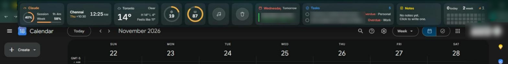
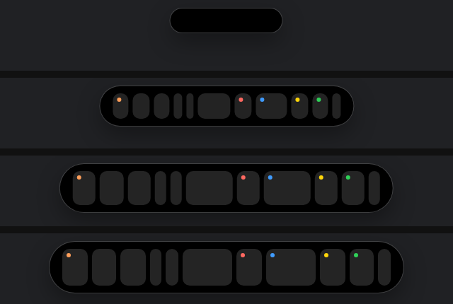

# GlassDock

A glass widget dock for Windows 11. Push your pointer up past the top middle of any screen and
it slides down; move away and it slides back up.


Frosted glass over any app, here over Google Calendar in Chrome:



Push past the top edge and a small capsule stretches out, with a miniature of your dock inside,
before the dock springs open:



## Features

- **Out of the way until you want it.** Resting the pointer at the top does nothing, so browser
  tabs and search bars work as usual. Keep pushing up past the edge and a thin glass lip slides
  out; push a little more and the dock springs open. Clicking or typing cancels it. Or press
  **Ctrl + Alt + Space** from anywhere. It works on whichever monitor your pointer is on and never
  takes keyboard focus from the app you're working in.
- **Real frosted glass.** The dock blurs whatever is behind it, an app or the desktop, with
  continuous (squircle) corners, card sizes that always line up, Inter type, and spring motion.
- **Stays private.** Hidden from screen sharing, recordings and screenshots (switch this off in
  settings if you want screenshots of it), and it won't open while you're presenting.
- **Meeting heads-up.** Five minutes before a meeting the closed dock glows softly at the top, and
  the Calendar card shows a **Join** button for Google Meet.
- **Make it yours.** Drag cards to rearrange them, switch widgets on and off, and choose Light,
  Dark or Auto per card. Rings and highlights follow your Windows accent colour.
- **Starts with Windows**, like Discord, and **updates itself** from this repository's releases.

### Widgets

| Widget | What it shows |
|---|---|
| World clocks | Analog or digital clocks for any cities; search and add from the panel |
| CPU, RAM, GPU | Live load rings (NVIDIA GPUs) |
| System | CPU, RAM, GPU and network speed in one card |
| Media | Whatever is playing in Windows (Spotify, browsers, Media Player), with controls; a small tile when nothing plays |
| Weather | Current conditions, high and low, feels-like; click to pick the city |
| Calendar | Your next events from one or more Google accounts; create meetings (guests, Google Meet) and tasks |
| Tasks | Google Tasks: tick off and add tasks |
| Notes | Quick notes kept on your PC |
| GitHub | Today, this week and streak over a contribution grid; your PRs, review requests and issues |
| Claude | Your Claude plan's session and weekly usage, refreshed every 5 minutes |
| Recycle Bin | Items in the bin; open or empty it (always asks first) |

## Install

1. Download `GlassDock_x.y.z_x64-setup.exe` from the [Releases](../../releases) page.
2. Run it. GlassDock isn't code-signed yet, so Windows SmartScreen will warn you: choose
   **More info → Run anyway**.
3. Push the pointer up past the top middle of your screen, or press Ctrl + Alt + Space.

Requires Windows 10 or 11 with WebView2 (already part of Windows 11).

## Using it

- **Click a card** to open its panel: edit cities, see your week, write notes and more.
- **Drag a card** to move it.
- **Right-click a card** for Light / Dark / Auto, Move left / right and Hide.
- **Right-click the dock's edge** to switch widgets on or off, pick a Dark or Light dock, choose
  wallpaper tint or neutral glass, and turn **Start with Windows** on or off.

### Connecting accounts

Everything is optional. Widgets you don't connect simply show a "Connect" card.

- **Google Calendar and Tasks:** you need your own Google Cloud OAuth client (type
  *Desktop app*) with the Calendar and Tasks APIs enabled. Click the Calendar card, choose the
  client's JSON file, then **Add a Google account** for each account.
- **GitHub:** create a fine-grained personal access token with read-only Contents, Issues,
  Pull requests and Metadata, click the GitHub card and paste it.
- **Claude:** needs [Claude Code](https://code.claude.com) signed in on the same PC (run `claude`
  once). GlassDock then reads your plan usage every 5 minutes, using the sign-in Claude Code saved;
  it only reads it, and only sends it to Anthropic. This uses the same check as Claude Code's
  `/status` command, which Anthropic doesn't document for other apps, so it could change. If it
  stops working, **Connect Claude Code** on the card switches to Claude Code's status line instead.

## Privacy

GlassDock has no servers and collects nothing. Data goes only between your PC and the services
you connect (Google, GitHub, Open-Meteo for weather and city search). Sign-in tokens are kept in
Windows Credential Manager; settings and notes stay in your user profile. The picture of the
screen used for the frosted glass is taken as the dock opens, kept in memory only, and never saved
or sent anywhere.

## Building from source

You need [Node.js](https://nodejs.org) (LTS) and [Rust](https://rustup.rs) with the Visual Studio
C++ build tools.

```
npm install
npm run tauri dev      # run with live reload
npm run tauri build    # make the installer (src-tauri/target/release/bundle/nsis/)
```

See [docs/DEVELOPMENT.md](docs/DEVELOPMENT.md) for the project layout and how to write your own widget.

## Credits

Built with [Tauri](https://tauri.app). Weather and city search by
[Open-Meteo.com](https://open-meteo.com/). Typeface: [Inter](https://rsms.me/inter/) by Rasmus
Andersson. Full list in [THIRD_PARTY_NOTICES.md](THIRD_PARTY_NOTICES.md).

Claude, GitHub, Google, Spotify and Windows are trademarks of their respective owners. GlassDock
isn't affiliated with or endorsed by any of them.

## Licence

[MIT](LICENSE)
